# Geopolitics Conquest

A single-player, Risk-inspired world-domination game for the INF4001 entrance exam. You play one real country
against nine random rivals on a real world map. Dice decide every fight. The last nation standing wins.

**Stack:** TypeScript monorepo · React 18 + Vite · d3-geo (Natural Earth 50m) · Firebase Auth + Firestore (NoSQL) ·
OpenRouter LLM (optional) · Vitest. Hosted as a static site (Render) plus Firebase.

## Live site and marker access

<!-- ADD YOUR DETAILS HERE: replace every REPLACE_ME, then delete this comment. Use a throwaway demo account. -->

| | |
|---|---|
| Live site | REPLACE_ME (for example https://geopolitics-conquest.onrender.com) |
| Demo login | email: REPLACE_ME / password: REPLACE_ME (a throwaway account created for marking) |
| Database | Firebase project `REPLACE_ME` (Firestore). Viewer access is granted to ammarcanani@gmail.com, mc.tanner@uct.ac.za and ridewaan.hanslo@uct.ac.za |
| Source | the submitted zip, or REPLACE_ME (GitHub URL, if the repository is shared) |

Anyone can open a shared game link (`/?watch=<id>`) without signing in. Playing needs an account: use **Create account**
or the demo login. The first request after a quiet period can take a few seconds while the free host wakes up.

## What the brief asked for, and where it lives

| Requirement | Where |
|---|---|
| 10 countries: yours + 9 random, soldiers from population | `packages/data` (Worldometers 2026 snapshot), `engine/src/soldiers.ts` |
| Turn rules, 1:1 dice pairing, conquest, reinforcements, elimination | `packages/engine` (pure TypeScript, 100% unit-tested) |
| Fast-forward that still shows the gameplay | speed 1x–16x and **To my turn**: every event is still played, only shorter |
| Visible battles: attacks, dice, losses, outcomes | 3-D dice drawer (`web/src/battle`), ticker, log |
| AI commentary, accurate | `web/src/ai`: the LLM only narrates facts the engine supplies, and every answer is fact-checked (see below) |
| NPCs play to win and justify every move | `engine/src/npc` (exact odds, garrisons, focus), shown in "Rival decisions" |
| Visitors can watch, only the owner can play | spectator link `?watch=<id>`; `firestore.rules` |
| Anyone can sign up and start their own game | Firebase email/password |
| NoSQL database, deployed | Firestore, static site on Render |

**Declared bonus feature: #1, AI/LLM makes decisions for an NPC.** One rival per game (the strongest at the start)
is the *strategist*: before it attacks, the engine lists up to three legal, verified attack options and an LLM picks
one and explains why. The LLM can only return an index into that list, so it can never invent an illegal move, and the
engine still validates the resulting action. Any failure falls back to the built-in heuristic. Also built along the
way: real-time spectating (#10), dice-accurate replay (#5), difficulty levels (#6, measured), analytics (#3), and
graphics/animation (#4).

## Screenshots

<!--
HOW TO ADD A SCREENSHOT
1. Take the screenshot (macOS: Shift + Command + 4, then Space, then click the window).
2. Save it in docs/images/ using the exact file name shown in the cue below.
3. Run:  bash finalize-geopolitics-conquest.sh --screenshots
   It switches on every image that exists and commits it. Or do it by hand: delete the cue comment above an
   image and remove the surrounding "<!--" and "-->" from the image line.
-->

### Splash screen
<!-- SCREENSHOT: save as docs/images/01-splash.png (the title page, before pressing Enter) -->
<!-- 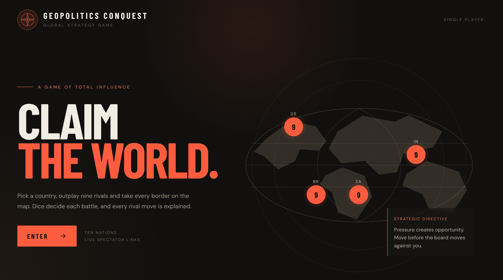 -->
The title page: brand, headline, etched world with unit markers, and the Enter button.

### Menu
<!-- SCREENSHOT: save as docs/images/02-menu.png (country picker with a country selected and difficulty chosen) -->
<!-- 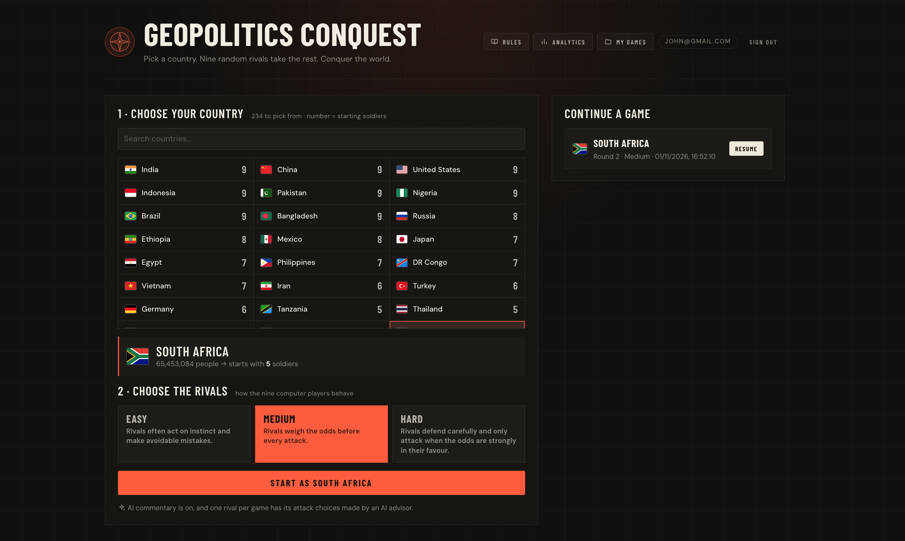 -->
Pick any country from the world list (searchable), choose Easy, Medium or Hard, and start. Nine random rivals fill the board.

### In-game board
<!-- SCREENSHOT: save as docs/images/03-game.png (mid-game, map with all ten badges and the action dock visible) -->
<!-- 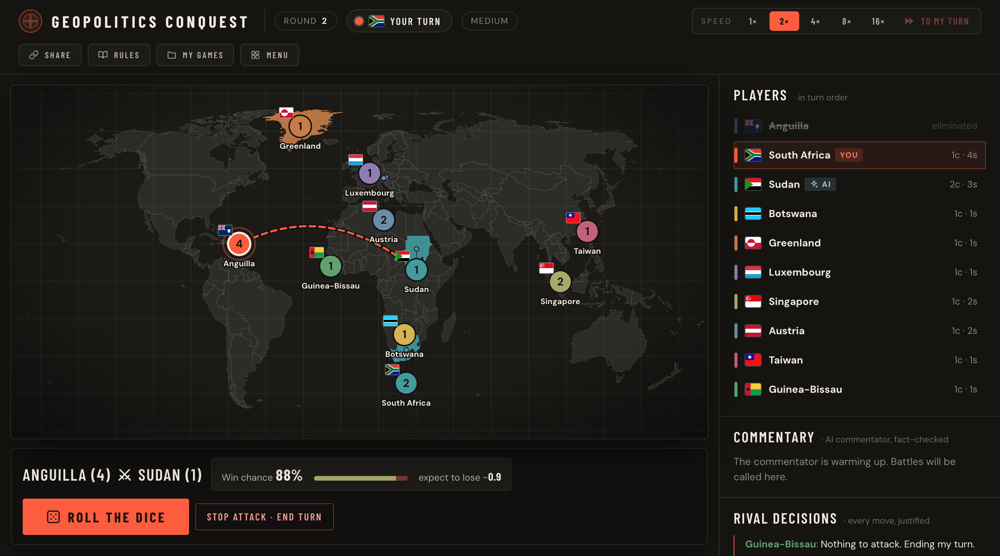 -->
Every country and its soldier count is always visible. The action dock under the map holds the reinforcement, attack and transfer controls.

### Battle with live commentary
<!-- SCREENSHOT: save as docs/images/04-battle.png (the battle drawer open with dice showing and a commentary line) -->
<!-- 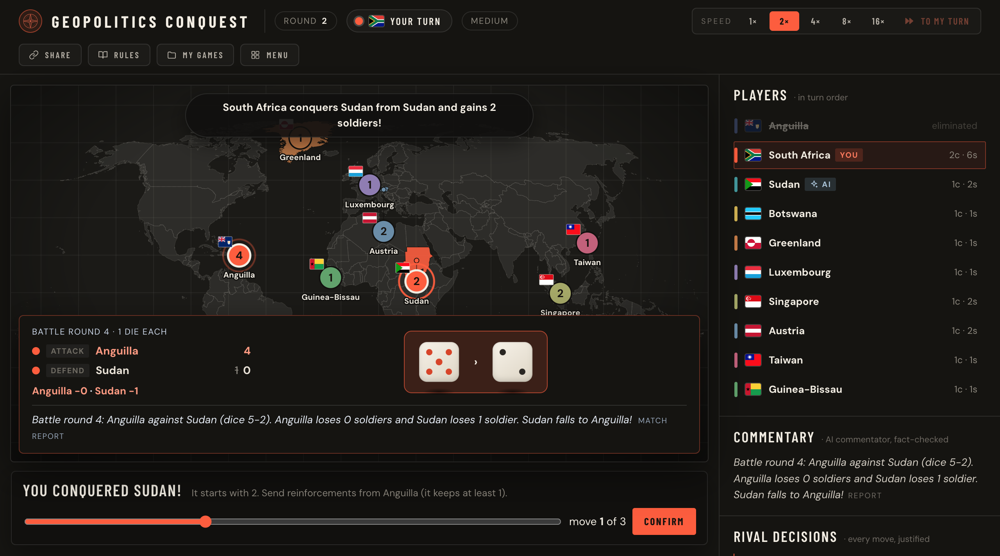 -->
Dice are rolled in pairs, soldier against soldier. The drawer shows each roll, the losses and the outcome, with AI commentary.

### Rival decisions with justifications
<!-- SCREENSHOT: save as docs/images/05-decisions.png (the sidebar Rival decisions panel with a few entries) -->
<!-- 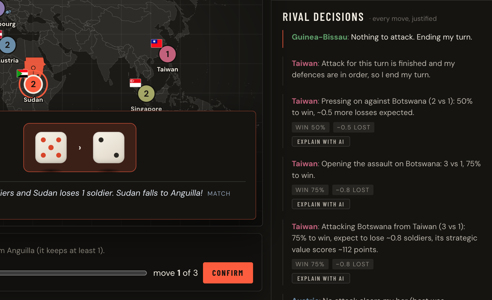 -->
Every NPC decision is listed with its reason, including while fast-forwarding. Decisions made by the AI strategist are labelled.

### Rules
<!-- SCREENSHOT: save as docs/images/06-rules.png (the How to play popup) -->
<!-- 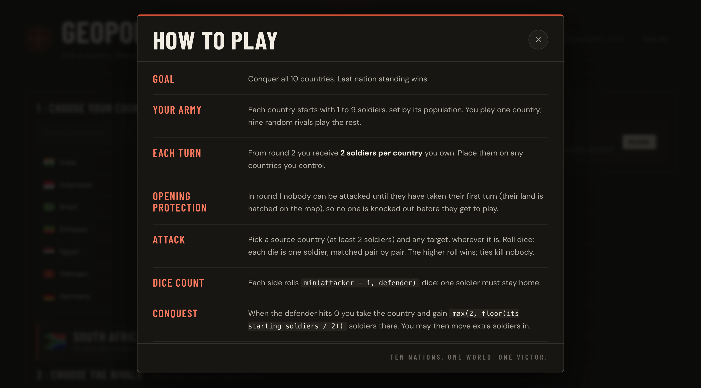 -->
The rules are one click away from the menu and from inside a game.

### My games (with filter)
<!-- SCREENSHOT: save as docs/images/07-my-games.png (the list with the filter tabs, ideally on Won or In progress) -->
<!-- 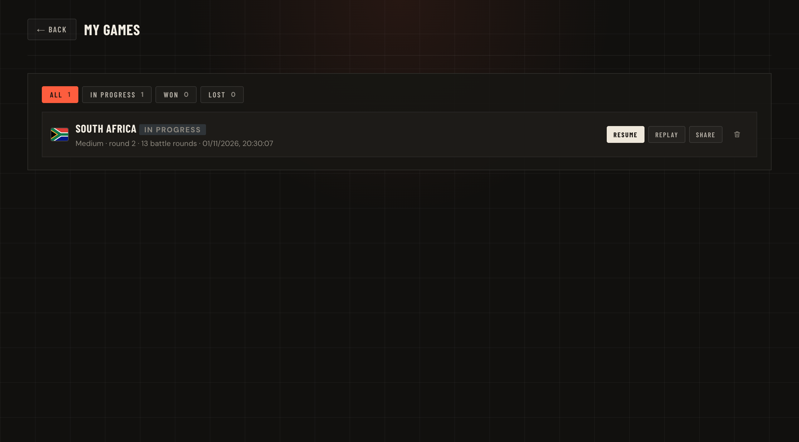 -->
Every game you have played, filterable by All, In progress, Won and Lost. Resume, replay, share or delete from here.

### Replay
<!-- SCREENSHOT: save as docs/images/08-replay.png (a replay paused mid-game with the controls visible) -->
<!-- 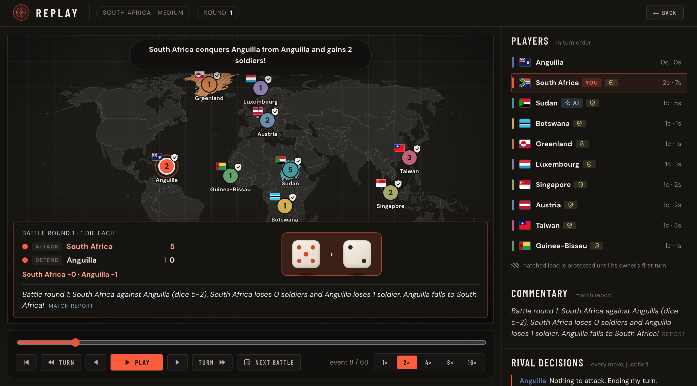 -->
Any game can be replayed turn by turn or battle by battle. Dice are reproduced exactly because the random generator is seeded.

### Analytics
<!-- SCREENSHOT: save as docs/images/09-analytics.png (the Analytics screen with personal and platform sections) -->
<!-- 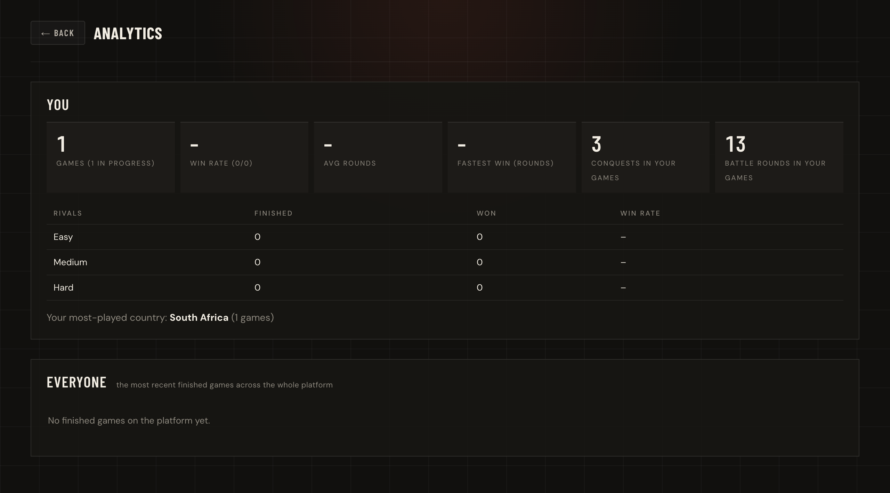 -->
Your own results and the platform as a whole: games finished, win rates and results by difficulty.

### Spectator view
<!-- SCREENSHOT: save as docs/images/10-spectator.png (the shared link opened in a private window, showing the live banner) -->
<!-- 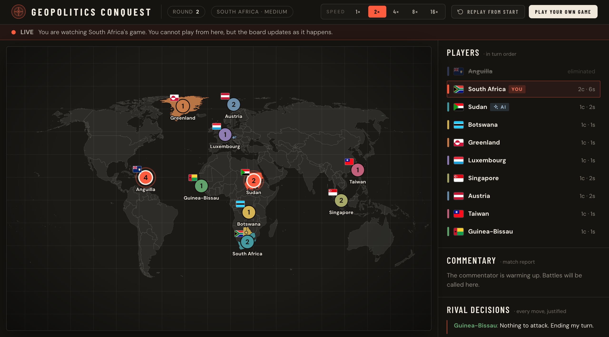 -->
Anyone with the link can watch a game live without signing in. Only the signed-in owner can play.

## Run it

```bash
npm install                      # once, at the repo root
npm run dev                      # http://localhost:5173 (predev copies the map + flags into public/)
npm test                         # engine + data + web
npm run typecheck
npm run build
```

Without Firebase configured, `npm run dev` shows a clearly-labelled **local guest** (games are saved in your
browser). **A production build has no guest and no built-in credentials**: it needs Firebase.

### Firebase setup (about 10 minutes)

1. Firebase console: create a project; **Build → Authentication → Sign-in method → Email/Password: enable**.
2. **Build → Firestore Database → Create database** (production mode).
3. Project settings → Your apps → add a Web app; copy the four values into `packages/web/.env.local`
   (see `.env.example`).
4. Deploy the rules (this is what makes the data safe; see `docs/security.md`):
   `npx firebase-tools deploy --only firestore:rules`.
5. Authentication → Settings → **Authorized domains**: add your Render domain.
6. Create the demo account for the markers (Authentication → Users → Add user), and add the marker emails as
   **Viewer** in Project settings → Users and permissions.

### Deploy to Render

New → Blueprint → this repo (`render.yaml`). Set the four `VITE_FIREBASE_*` values. Optionally set
`VITE_LLM_PROXY_URL` (see `infra/llm-proxy/README.md`).

## Architecture

The diagram below is rendered by GitHub directly from Mermaid. The source is in `docs/architecture.mmd`.

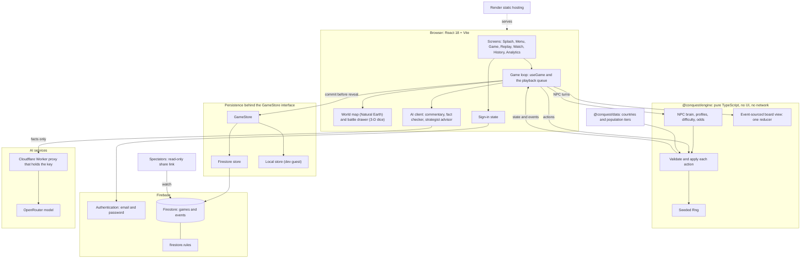

<!--
OPTIONAL: USE A DRAW.IO IMAGE INSTEAD OF (OR AS WELL AS) THE DIAGRAM ABOVE
1. Open https://app.diagrams.net and create a blank diagram.
2. Menu: Arrange > Insert > Advanced > Mermaid...
3. Paste the contents of docs/architecture.mmd and press Insert. Tidy it if you like.
4. Menu: File > Export as > PNG (zoom 200%, border 10). Save it as docs/images/architecture.png.
5. Delete this comment and un-comment the next two lines (remove the "<!--" and "-->" around the image line).
-->
<!-- SCREENSHOT: save as docs/images/architecture.png (exported from draw.io) -->
<!-- 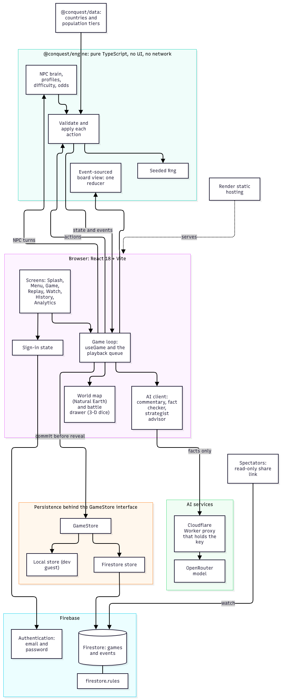 -->

### What happens when a move is made

The result is saved before it is shown (commit-then-reveal), so reloading or closing the tab cannot undo a roll.
Source: `docs/commit-then-reveal.mmd`.

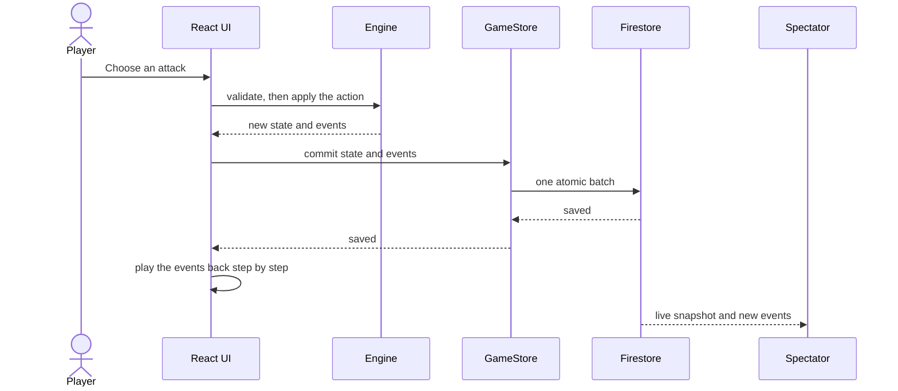

## Design and object-oriented notes

The code is organised in three layers, each with a single responsibility and no knowledge of the layers above it.

* **Rules engine (`packages/engine`).** A functional core: applying an action to a state returns a new state and a list of
  events, and `validateAction` is the gate that decides whether a move is legal. State is never mutated outside
  it, which is how the engine encapsulates its invariants (soldiers never below 1 on a source country, one attack per
  turn, protection and elimination rules). The random generator is a class, `Rng`, that hides its seed state, so the same seed always
  gives the same dice and tests can inject fixed rolls and replays reproduce every roll exactly. Illegal moves
  raise a typed `IllegalActionError`.
* **NPC intelligence (`engine/src/npc`).** Each rival plays a profile (balanced, aggressive or defensive), which is a
  plain configuration object that the same decision function interprets: one algorithm, several behaviours (the
  strategy pattern). The optional LLM advisor is a hook, so the heuristic, a test double and the real model
  are interchangeable, and any advisor failure falls back to the heuristic.
* **Persistence (`packages/web/src/game/store`).** The UI depends on the `GameStore` interface, never on Firebase.
  `firestoreStore` and `localStore` implement it (polymorphism and dependency inversion), which keeps the database layer
  separate from the rest of the application and is what makes the whole app testable against an in-memory fake.

On purpose, the rules are functions on immutable data rather than a large `Game` class with mutable fields. That makes
every state transition a pure, testable step and makes the event log, replay and spectator view possible: one event reducer
serves the live game, the spectator and the replay, so they cannot disagree.

## How the AI is kept honest

The engine decides everything. The LLM never sees an action it could invent: it is handed a JSON of facts and asked to
narrate. Before anything is shown it is checked (`web/src/ai/facts.ts`): every number must appear in the facts, only
the two combatants may be named (any other real country is rejected), and it may not claim a conquest that did not
happen. Anything that fails, times out or errors is replaced by a factual template, so commentary is always correct.
Tests include deliberately wrong answers. At speeds above 2x the template is used (the model cannot keep up).

## Security model, honestly

* Anything `VITE_`-prefixed is public. Firebase's web config is meant to be; **an LLM key is not**, so use the proxy.
* `firestore.rules`: anyone may *read* a game (that is the spectator feature); only the signed-in owner may create,
  change or delete it; ownership and the starting board are immutable; the version can only go up; events are
  append-only; a finished game cannot be edited.
* There is no game server, so the rules cannot re-run the engine. A signed-in owner who edits their own browser can
  falsify **their own** game. Every move is saved *before* its result is shown ("commit-then-reveal"), so closing the
  tab mid-attack cannot be used to peek at a roll and undo it. See `docs/security.md`.

## Difficulty is measured, not assumed

A competent player (the balanced heuristic) wins about **11%** against Medium rivals (chance is 10%), about **40%+**
against Easy and a little over **7%** against Hard. Hard's edge over Medium is real but modest and needs a few hundred
games to resolve. Re-run: `npm run report:difficulty -w @conquest/data -- 600`. Details: `docs/difficulty.md`.

## Layout

```
packages/engine   rules, NPC brain, difficulty, event→board reducer          (no UI, no network)
packages/data     country dataset + build script
packages/web      the app: map, dice, game loop, stores, auth, AI, replay
firestore.rules   database security      infra/llm-proxy   optional key-holding proxy
docs/             rules, architecture, security, difficulty, data
```

## Credits

Population: Worldometers (UN WPP). Map: Natural Earth via `world-atlas` (public domain). ISO data: `world-countries`
(ODbL). Flags: `flag-icons` (MIT). Dice, UI and code: this project.

## About the git history

Version 2 was written before it was committed. The history on `main` was reconstructed afterwards from that
snapshot, grouped by feature, followed by a review pass. Commit timestamps are the real time those commits were made.
